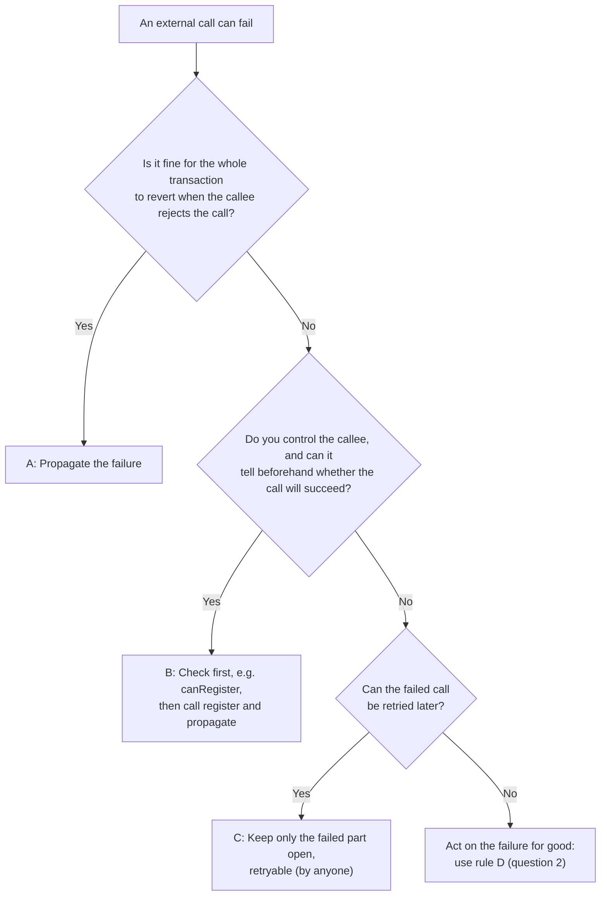
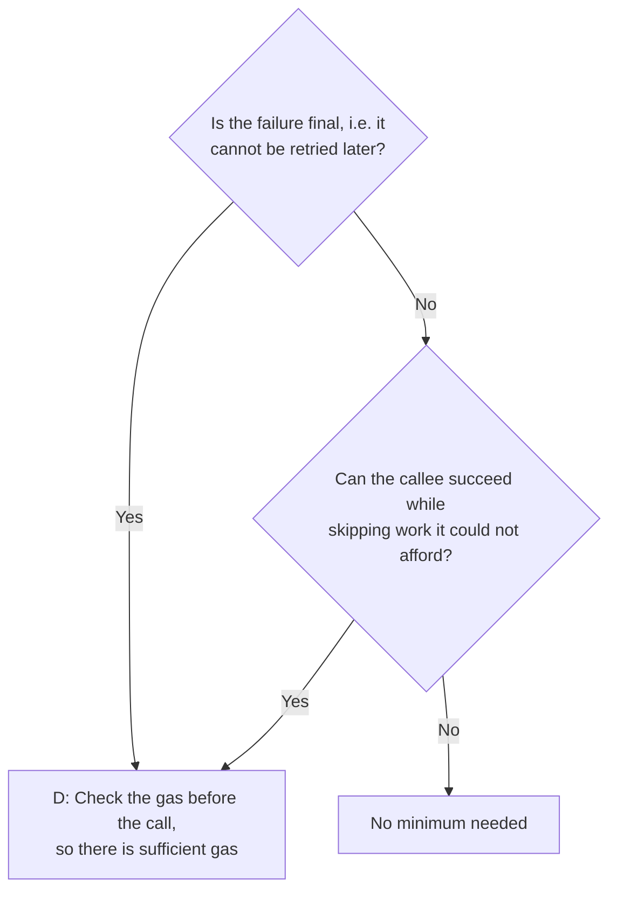
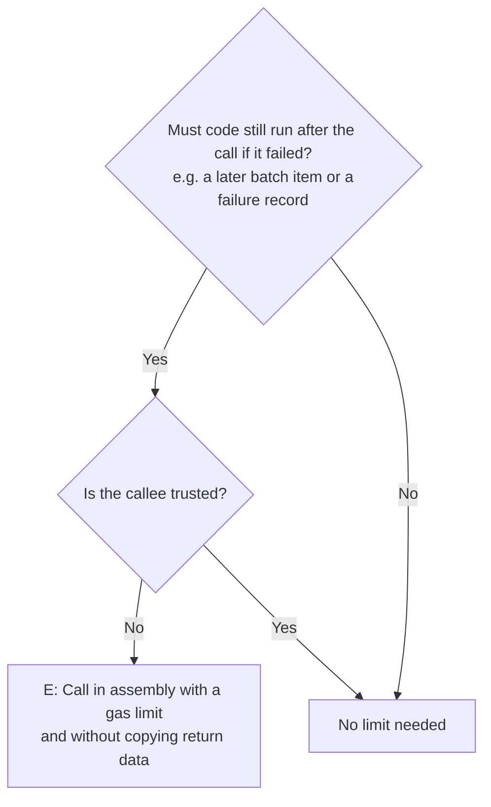

# Handling call failures

Many of the broken invariants (INV-1, INV-2, INV-3, INV-6, INV-7) share the same root: code makes an external call, the call fails, and the code *continues*.

Continuing is sometimes the right design. One bad item should not block a whole batch or queue, a receiver that always reverts should not lock a withdrawal for good, and a deposit may have to be refunded when a callback fails.

The danger is that **whoever picks the gas of the transaction can make the call fail on purpose**, by running it out of gas. The attacker can then trigger whatever the code does on failure.

As a **bad example** of continuing, consider:

```solidity
try feeModel.getFee(amount) returns (uint256 f) { fee = f; } catch { fee = 0; }
```

This is bad because anyone who makes `getFee` run out of gas pays no fee.

## Which rules to use

Answer three questions. Each "yes" points to a rule, and the rules combine.

**1. How do you handle a rejection by the callee?**



**2. Do you need to make sure the callee receives at least a certain amount of gas?**



**3. Do you need to limit the amount of gas the callee can consume?**



## Rule A: propagate the failure

If nothing has to happen after a failed call, revert with it. A regular Solidity call does this for you: when the callee reverts, the caller reverts with the same data.

```solidity
registry.register(user); // no try/catch: a failure reverts the whole transaction
```

With a low-level `call`, bubble the failure up yourself:

```solidity
(bool success, bytes memory returnData) = target.call(data);
if (!success) {
    assembly { revert(add(returnData, 0x20), mload(returnData)) } // bubble up the callee's revert data
}
```

- **Propagate all the way up.** If your own contracts call this one, they must not catch the failure either.
- **A low-level call to an address without code succeeds.** If `target` must be a contract, check `target.code.length > 0` first. A regular Solidity call does this for you.

## Rule B: check first, then act

If you control both caller and callee, let the callee answer whether the action will succeed, and only then do it:

```solidity
if (registry.canRegister(user)) {
    registry.register(user); // a failure here is propagated (rule A)
} else {
    // the logical rejection: handle it
}
```

The logical failure is now a return value, not a caught failure, so it cannot be forced with gas. For this to hold, `register` must not fail for a logical reason after `canRegister` returned true, that is,  `canRegister` must make exactly the checks `register` makes.

## Rule C: make the failure retryable

If the code must continue, record the failure as *pending*, not as final, and let it be retried later with more gas:

```solidity
mapping(bytes32 => bool) public failed;

function _deliver(bytes32 id, address target, bytes memory data, uint256 gasLimit) internal {
    bool success;
    assembly { success := call(gasLimit, target, 0, add(data, 0x20), mload(data), 0, 0) } // no return data copied
    if (!success) failed[keccak256(abi.encode(id, target, data))] = true; // still open
}

function retry(bytes32 id, address target, bytes calldata data) external { // anyone can retry, one item at a time
    bytes32 key = keccak256(abi.encode(id, target, data));
    require(failed[key], "not failed");
    delete failed[key];
    (bool success, bytes memory returnData) = target.call(data);
    if (!success) assembly { revert(add(returnData, 0x20), mload(returnData)) } // rule A
}
```

- **Keep only the failed part open.** In a batch, record each item that failed, so that a retry runs only those and an item that succeeded cannot run twice.
- **Let anyone retry**, if possible, so that delivery does not depend on one party staying online.
- **Propagate the failure of the retry** (rule A), so that a retry with too little gas changes nothing. This holds only if the callee cannot succeed while skipping work. Otherwise a callee that succeeds on too little gas closes the item for good, in `_deliver` or in `retry`, so apply rule D in both.
- **Make each item unique.** `id` must identify exactly one item.
- **A call to an address without code succeeds** and closes the item, as in rule A. Check `target.code.length` if the target must be a contract.
- **Retries run when someone else chooses.** If the action depends on time or order (a swap, a price update, messages that must arrive in order), consider the risks.
- **Budget for the record.** Marking an item as failed creates a new slot: 110,020 under Glamsterdam.

## Rule D: make sure the callee receives enough gas

Sometimes a failure must be acted on for good, e.g. record a broken contract. Then the code has to be sure the call failed for a logical reason (e.g. the callee was broken by an upgrade) and not because the caller supplied too little gas.

The same holds when the callee can succeed while skipping work it could not afford: its success only means something if it had its full budget.

**Do not try to recognise out-of-gas afterwards. Make it impossible beforehand.**

Check before the call that EIP-150 will allow all of `gasReq` to be forwarded. For a call that sends no ETH (for ETH, also count the value transfer and possible account creation, see below):

```solidity
uint256 gasToBeForwarded = (gasleft() - gasForwardingOverhead) * 63 / 64;
require(gasToBeForwarded >= gasReq, "Insufficient gas");

(bool success,) = target.call{gas: gasReq}(data); // copies return data: use rule E for untrusted targets
```

- **`gasForwardingOverhead` must bound every gas charge from the `gasleft()` measurement through the up-front costs of the CALL.** That covers:
  - the arithmetic and the `require`
  - reading `gasForwardingOverhead` itself from storage
  - loading `target`, `gasReq` and `data` if they are read after the measurement
  - memory expansion for the calldata, and the copy of `data` that Solidity makes for `target.call(data)` after the measurement: cap the length of `data` and measure at the cap, or call in assembly on the existing buffer
  - Solidity's code-size check, only if you use a high-level call
  - the target's account access, cold in the worst case, plus the extra access when the target is an EIP-7702 delegated account
  - if the call sends ETH, the value transfer, and when the recipient may be an empty account, the account creation (183,600 of state gas under Glamsterdam)

  With a valid bound, the pre-check guarantees that the target receives `gasReq`.
- **`gasReq` must exceed the gas needed by every permitted execution path of the callee.** This is what ensures that `gasReq` is actually enough. Under Glamsterdam it must include the state gas of every slot and account the callee may create. Watch paths that depend on state, such as a first-time token recipient.
- **Checking normal gas only is enough here.** `gasleft()` does not include the reservoir, but the reservoir only adds to what the callee gets: it still receives `gasReq` of normal gas, and can pay state gas from the reservoir on top.
- **If `gasReq` and `gasForwardingOverhead` are chosen correctly, the failure will not be out-of-gas.** A failed call is then a logical failure and can be handled as one. A call to an address without code succeeds, so check `target.code.length` if the target must be a contract.
- **For an untrusted target, make the call as in rule E**, with `gasReq` as the limit. The plain call above forwards only `gasReq` but copies all return data. Measure `gasForwardingOverhead` with the call you actually use.
- **Make `gasReq` and `gasForwardingOverhead` modifiable**, so they can be adjusted when a future hardfork reprices gas. Often they should be set by governance.
- **Keep `gasReq` well below 2^24.** A transaction's normal gas is capped at 2^24. With a larger `gasReq` the call can never be made, so enforce a maximum wherever `gasReq` is set.

## Rule E: limit the gas the callee can consume

A callee you do not trust can waste the caller's gas in two ways, and the code after the call then runs out of gas:

- **It burns all the gas it gets.** Without a limit, a call forwards 63/64 of the gas left, and the caller keeps only 1/64.
- **It returns a lot of data.** Solidity copies all return data into memory, even with `(bool success,) =`, where it is ignored, and even with `{gas: ...}`.

Plain Solidity can limit the gas, but not the copy. Make the call in assembly, with a gas limit and no output buffer:

```solidity
bool success;
assembly {
    success := call(gasLimit, target, 0, add(data, 0x20), mload(data), 0, 0) // at most gasLimit, no return data copied
}
```

- **If you need the revert data**, copy a bounded amount yourself with `returndatacopy`, up to a fixed maximum.
- **Like any low-level call, it succeeds on an address without code**.
